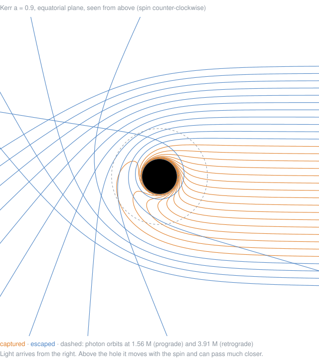

# How the rays are traced

This note walks through what happens to one pixel: how its light ray is set up at the
camera, how it's carried through the Kerr spacetime, and how the colour it ends up with is
worked out. The shader is [`src/shaders/blackhole.wgsl`](../src/shaders/blackhole.wgsl);
[`src/physics/kerr.ts`](../src/physics/kerr.ts) has the same equations in 64-bit
TypeScript, and that's the copy the tests check.

*Parallel light rays in the equatorial plane, integrated with `src/physics/kerr.ts`
([`scripts/ray-figure.ts`](../scripts/ray-figure.ts)). The capture region is lopsided: rays
moving with the spin can pass as close as the prograde photon orbit, while rays moving
against it are captured much farther out. Seen from the camera, this is the D-shaped
shadow.*

## Units and coordinates

Geometrized units, $G = c = M = 1$: lengths and times are in units of the hole's mass.
The spin is $a = J/M$, between −1 and 1. Coordinates are Boyer–Lindquist
$(t, r, \theta, \varphi)$, with the spin axis at $\theta = 0$. Three combinations show up
everywhere:

$$
\Sigma = r^2 + a^2\cos^2\theta, \qquad
\Delta = r^2 - 2r + a^2, \qquad
A = (r^2 + a^2)^2 - a^2\Delta\sin^2\theta .
$$

The event horizon is the outer root of $\Delta = 0$, $r_+ = 1 + \sqrt{1 - a^2}$.

## Photons as a Hamiltonian system

A photon's path is a null geodesic. Rather than solving the second-order geodesic equation,
the tracer uses the equivalent Hamiltonian form: with $H = \tfrac12 g^{\mu\nu}p_\mu p_\nu$,
Hamilton's equations $\dot x^\mu = \partial H/\partial p_\mu$,
$\dot p_\mu = -\partial H/\partial x^\mu$ trace the geodesic, and $H = 0$ along it because
the photon is massless. The dot is the derivative along the ray.

The metric doesn't depend on $t$ or $\varphi$, so $p_t$ and $p_\varphi$ are constants. Each
ray is normalized so its energy at infinity is $E = -p_t = 1$; its axial angular momentum
$L = p_\varphi$ is then also its impact parameter. That leaves five numbers to integrate,
$(r, \theta, \varphi, p_r, p_\theta)$. Writing $P = r^2 + a^2 - aL$,

$$
2\Sigma H \equiv F = \Delta\,p_r^2 + p_\theta^2 - \frac{P^2}{\Delta}
  + \left(\frac{L}{\sin\theta} - a\sin\theta\right)^2 ,
$$

and the equations of motion are

$$
\dot r = \frac{\Delta\,p_r}{\Sigma}, \qquad
\dot\theta = \frac{p_\theta}{\Sigma}, \qquad
\dot\varphi = \frac{1}{\Sigma}\left(\frac{aP}{\Delta} - a + \frac{L}{\sin^2\theta}\right),
$$

$$
\dot p_r = -\frac{1}{2\Sigma}\frac{\partial F}{\partial r}, \qquad
\dot p_\theta = -\frac{1}{2\Sigma}\frac{\partial F}{\partial \theta},
$$

with

$$
\frac{\partial F}{\partial r} = \Delta' p_r^2 - \frac{4rP\Delta - P^2\Delta'}{\Delta^2}, \quad
\Delta' = 2r - 2, \qquad
\frac{\partial F}{\partial\theta} = -\frac{2L^2\cos\theta}{\sin^3\theta} + 2a^2\sin\theta\cos\theta .
$$

The derivative of $H = F/2\Sigma$ would also have a term with $\partial\Sigma$, but it's
multiplied by $F$, which is zero on a null ray, so it's dropped. The time $t$ isn't needed
for a still image, so it isn't integrated.

$E$ and $L$ are conserved exactly, because they're constants in the code. Kerr has a third
conserved quantity, the Carter constant, which this form doesn't enforce; how well $H$
stays at zero is the accuracy check instead (see [Tests](#tests)).

## The camera

The camera floats at $(r, \theta, \varphi)$ in the *zero-angular-momentum frame* (ZAMO):
an observer who is dragged around with the hole's rotation but has no angular momentum of
their own. Their local orthonormal axes point along $e_{\hat r}$, $e_{\hat\theta}$ and
$e_{\hat\varphi}$, and the camera looks at the hole along $-e_{\hat r}$, with north
($-e_{\hat\theta}$) up and $+e_{\hat\varphi}$ to the right. Pixel $(x, y)$ on a screen at
unit distance has viewing direction

$$
\mathbf{look} = \operatorname{normalize}(-1,\ -y,\ x)
\quad \text{in } (e_{\hat r}, e_{\hat\theta}, e_{\hat\varphi}).
$$

With $\rho = \sqrt\Sigma$, $\varpi = \sqrt{A}\sin\theta/\rho$, lapse
$\alpha = \rho\sqrt\Delta/\sqrt A$ and frame-dragging rate $\omega = 2ar/A$, a photon that
the camera sees travelling in unit direction $\mathbf n$ has (James et al. 2015,
Appendix A)

$$
E_\text{cam} = \frac{1}{\alpha + \omega\varpi n_\varphi}, \qquad
p_r = \frac{E_\text{cam}\,\rho\,n_r}{\sqrt\Delta}, \qquad
p_\theta = E_\text{cam}\,\rho\,n_\theta, \qquad
L = E_\text{cam}\,\varpi\,n_\varphi .
$$

$E_\text{cam}$ is the photon's energy as the camera measures it, for $E = 1$ at infinity;
it's needed for the redshift. The test `camera rays start on the light cone` checks that
these momenta give $H = 0$ for any direction and spin.

### Backward, not outward

The light that reaches pixel $(x, y)$ travels *toward* the camera, so
$\mathbf n = -\mathbf{look}$. The ray is set up with that incoming photon's momenta and
then integrated **backward** in time (negative steps), from the camera to wherever the
light came from.

It's tempting to skip this and launch a photon outward along $\mathbf{look}$, integrating
forward. In flat space, and around a non-spinning hole, the result is the same path. Around
a spinning hole it isn't: the Kerr metric is unchanged by reversing time only if you also
reverse the direction of rotation, $(t, \varphi) \to (-t, -\varphi)$. An outgoing photon
follows the *mirror image* of the path the incoming one took. The shadow comes out flipped
left to right, while the Doppler beaming, which is worked out separately, stays where it
belongs, so the D-shaped shadow sits on the wrong side of the bright half of the disk. The
test `camera rendering: the flat side of the shadow is on the approaching side of the disk`
pins this down against Bardeen's photon-orbit formulas.

## Integration

The state is advanced with classic fourth-order Runge–Kutta. The step size $h$ is
adaptive:

$$
h = \frac{s}{\dfrac{|\dot r|}{r - r_+} + |\dot\theta| + |\dot\varphi|},
$$

where $s$ is the *Quality* setting (0.06, 0.04 or 0.025, and 0.05 while the camera is
moving). Each step therefore moves the ray at most a fraction $s$ of its remaining
distance to the horizon, and at most $s$ radians in either angle. Far from the hole the
steps are large; near the horizon they shrink in proportion to $r - r_+$, so a falling ray
slows down instead of jumping past the horizon into the region where $\Delta < 0$.

The $\varphi$ term is $|\dot\varphi|$, not the arc length $|\dot\varphi|\sin\theta$, and
that matters near the spin axis. A ray with small $L$ heads almost straight over the pole.
Near it the $L^2/\sin^2\theta$ term in $F$ acts as a steep wall: $\theta$ turns around at
$\sin\theta \approx |L|/|p_\theta|$ (with $p_\theta$ its value away from the pole), a tiny
angle from the axis, and during the turnaround
$\varphi$ swings through about $\pi$. Weighting by $\sin\theta$ hides that swing, so the
integrator takes big steps straight through the turning point and the ray goes wild. In
the image that showed up as a bright vertical seam through the centre, where every pixel's
ray passes over a pole. Unweighted, the turnaround takes about $\pi/s$ steps and the
Hamiltonian stays at zero (test `rays passing close to the spin axis stay accurate`).

### When to stop

- **Horizon:** $r < 1.01\,r_+$. Going back in time, the light would have to come out of the
  horizon, so this pixel is part of the shadow and stays black.
- **Sky:** $r > \max(2r_\text{cam}, 60)$ and still receding (going backward, $\dot r < 0$).
  Space there is treated as flat. The star or grid colour is looked up in the direction
  the light came from, which is opposite to its velocity
  $\dot r\,e_r + r\dot\theta\,e_\theta + r\sin\theta\,\dot\varphi\,e_\varphi$.
- **Opaque disk:** less than 1% of the light left to collect (below).
- **Step limit:** 400, 700 or 1200 steps by quality. Rays that skim the photon sphere can
  circle many times, and the few that run out keep whatever disk light they had collected
  and get no sky. Only a thin sliver at the edge of the shadow is affected.

## The accretion disk

The disk is a geometrically thin sheet in the equatorial plane, from the innermost stable
circular orbit $r_\text{isco}$ (Bardeen, Press & Teukolsky 1972) out to
$\max(18, 2.5\,r_\text{isco})$. Negative spins on the slider flip the hole's rotation
while the disk keeps rotating toward $+\varphi$, so the same formulas cover a retrograde
disk.

A ray crosses the disk when $\cos\theta$ changes sign during a step. The crossing radius is
interpolated linearly within the step. Steps are small near the hole, so this is accurate
where it matters.

**Temperature.** The emitted flux has the thin-disk profile
$F(r) \propto r^{-3}\left(1 - \sqrt{r_\text{isco}/r}\right)$, the non-relativistic limit
of Novikov–Thorne. Its peak is at $r = \tfrac{49}{36}\,r_\text{isco}$. The local
temperature is $T = T_\text{disk}\,(F/F_\text{peak})^{1/4}$, where $T_\text{disk}$ is the
slider value.

**Redshift.** The gas moves on circular orbits with angular velocity and 4-velocity

$$
\Omega = \frac{1}{r^{3/2} + a}, \qquad
u = u^t\,(1, 0, 0, \Omega), \qquad
u^t = \frac{r^{3/2} + a}{r^{3/4}\sqrt{r^{3/2} - 3r^{1/2} + 2a}} .
$$

The gas measures the photon's energy as $E_\text{gas} = -p_\mu u^\mu = u^t(1 - \Omega L)$,
and the camera measures $E_\text{cam}$, so the frequency ratio is

$$
g = \frac{E_\text{cam}}{E_\text{gas}} = \frac{E_\text{cam}}{u^t\,(1 - \Omega L)} .
$$

This single number includes the Doppler shift, time dilation in the gas, gravitational
redshift, and the camera's own motion. On the side where gas comes toward the camera, $L$
has the same sign as $\Omega$, $g > 1$, and the light is blueshifted.

**Colour and brightness.** A blackbody at temperature $T$ seen with shift $g$ looks like a
blackbody at $gT$, so the colour is a blackbody colour at $gT$. Specific intensity divided
by frequency cubed, $I_\nu/\nu^3$, is the same for every observer along a ray (Liouville's
theorem), so integrated over frequency the brightness scales as $g^4$ times the emitted
flux. Turning off *Doppler & gravitational shift* sets $g = 1$.

**Several images.** Light can cross the disk more than once: in front of the hole, then
again after bending around it. Each crossing adds its emission weighted by the opacity
(about 0.7–0.97, depending on the turbulence pattern) and by how much light is still
coming through, then dims what's behind. Backward tracing meets the nearest crossing
first, so this is front-to-back compositing. That's how the lensed far side of the disk
shows through gaps in the near side.

## Precision on the GPU

WebGPU has no 64-bit floats, so the shader runs in 32-bit. Three places need care:

- **Near the horizon** $\Delta$ is a small difference of large numbers. Rays stop at
  $1.01\,r_+$, and the steps shrink in proportion to $r - r_+$ on the way in.
- **At the poles** $1/\sin\theta$ terms blow up. $|\sin\theta|$ is clamped to at least
  $10^{-4}$, and the step rule above keeps rays from reaching it in practice.
- **Long paths** around the photon sphere accumulate error. Hamiltonian drift is checked
  in 64-bit by the tests. The 32-bit shader has looser accuracy, but the visible errors
  are confined to rays that are already very dim.

## Tests

`npm test` runs [`test/kerr.test.ts`](../test/kerr.test.ts) against the TypeScript copy of
these equations:

| Test | What it pins down |
| --- | --- |
| Horizon and ISCO radii | $r_+$ and $r_\text{isco}$ for several spins, prograde and retrograde |
| Schwarzschild capture | rays just inside $b = 3\sqrt3$ fall in, just outside escape |
| Kerr capture thresholds, $a = 0.9$ | prograde and retrograde critical impact parameters match Bardeen (1973) |
| Camera rays on the light cone | the ZAMO momenta give $H = 0$ for any direction and spin |
| Hamiltonian drift | $H$ stays within $10^{-4}$ of zero along integrated rays |
| Rays near the spin axis | small-$L$ rays finish with $H$ near zero (the pole seam) |
| Shadow orientation | backward camera rays put the flat side of the shadow on the approaching side |
| Disk redshift | approaching side blueshifted, receding side redshifted, face-on $g = 1/u^t$ |

## References

- J. M. Bardeen, W. H. Press, S. A. Teukolsky, *Rotating black holes: locally nonrotating
  frames, energy extraction, and scalar synchrotron radiation*, ApJ 178, 347 (1972). The
  ZAMO frame, ISCO and circular-orbit formulas.
- J. M. Bardeen, *Timelike and null geodesics in the Kerr metric*, in *Black Holes*
  (Les Houches, 1973). Photon orbits and the shadow's outline.
- O. James, E. von Tunzelmann, P. Franklin, K. S. Thorne, *Gravitational lensing by
  spinning black holes in astrophysics, and in the movie Interstellar*, Class. Quantum
  Grav. 32, 065001 (2015). The Hamiltonian ray equations and camera setup used here.
- I. D. Novikov, K. S. Thorne, *Astrophysics of black holes*, in *Black Holes* (Les
  Houches, 1973). The thin-disk model.
